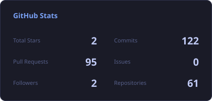
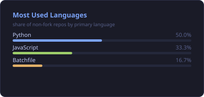
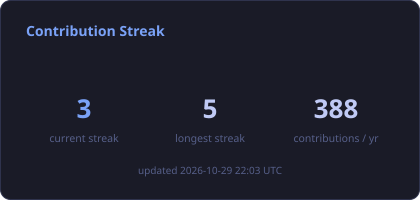
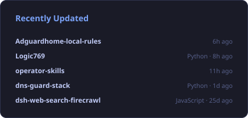
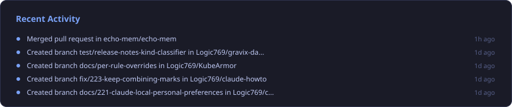

  

<picture><source media="(prefers-color-scheme: dark)" srcset="assets/stats-dark.svg" /><source media="(prefers-color-scheme: light)" srcset="assets/stats-light.svg" /></picture><picture><source media="(prefers-color-scheme: dark)" srcset="assets/top-langs-dark.svg" /><source media="(prefers-color-scheme: light)" srcset="assets/top-langs-light.svg" /></picture>

<picture><source media="(prefers-color-scheme: dark)" srcset="assets/streak-dark.svg" /><source media="(prefers-color-scheme: light)" srcset="assets/streak-light.svg" /></picture><picture><source media="(prefers-color-scheme: dark)" srcset="assets/recent-repos-dark.svg" /><source media="(prefers-color-scheme: light)" srcset="assets/recent-repos-light.svg" /></picture>

<picture><source media="(prefers-color-scheme: dark)" srcset="assets/activity-dark.svg" /><source media="(prefers-color-scheme: light)" srcset="assets/activity-light.svg" /></picture>

<picture>
  <source media="(prefers-color-scheme: dark)" srcset="https://raw.githubusercontent.com/Logic769/Logic769/output/github-snake-dark.svg" />
  <source media="(prefers-color-scheme: light)" srcset="https://raw.githubusercontent.com/Logic769/Logic769/output/github-snake.svg" />
  
</picture>

